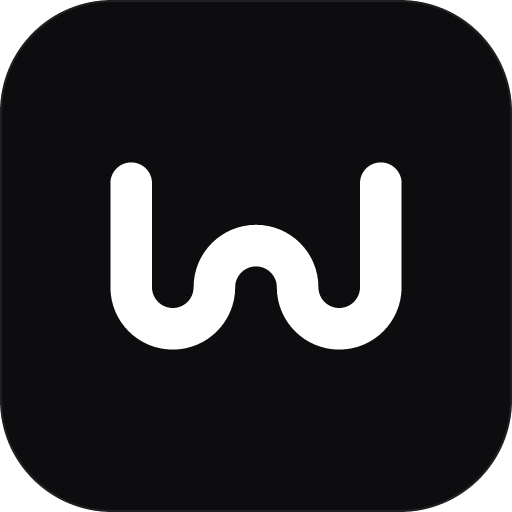
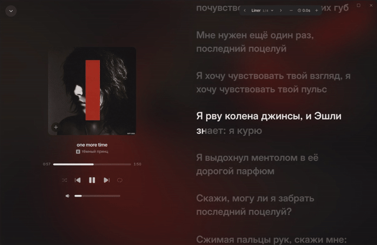
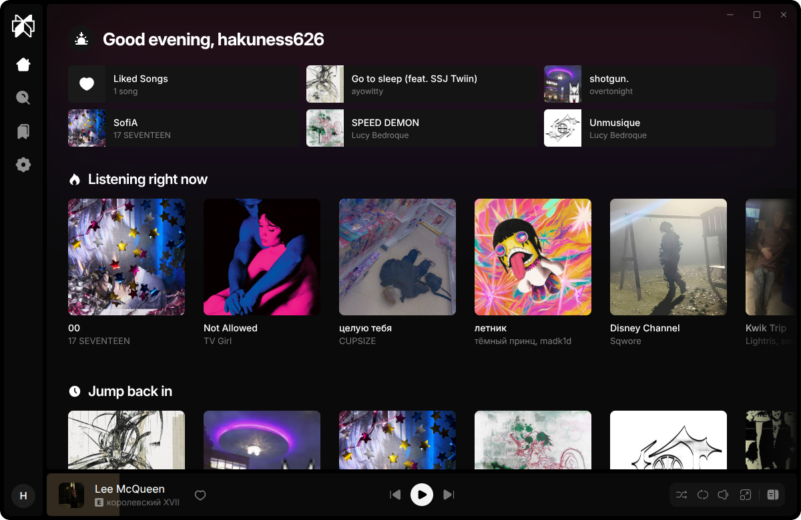
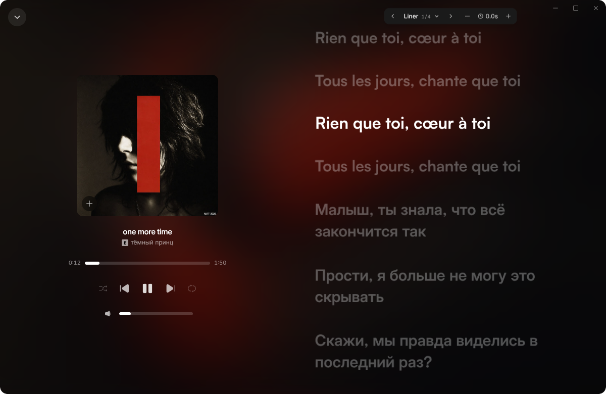

<div align="center">



# Wave

A desktop and Android music player built with Tauri, React and Rust.



</div>

## Features

- **Search and catalog** — tracks, albums, artists and playlists, daily mixes and radio by track.
- **Synced lyrics** — line and word highlighting that follows playback.
- **Offline** — download tracks and whole playlists, followed playlists are downloaded automatically, cache size is configurable.
- **Overlay player** — a compact always-on-top player on the desktop.
- **Playback** — global media shortcuts and a fullscreen player.
- **Customization** — themes, accent colors and alternative app icons.
- **Android** — the same app with a native media notification and background playback.

<p align="center">
  
  
</p>

## Stack

| | |
|---|---|
| UI | React 19, React Router, Zustand, TanStack Virtual, Tailwind CSS 4, Framer Motion |
| Native | Tauri 2, Rust, Kotlin (Android media service) |
| Build and tests | Vite, Vitest, Testing Library |

The client talks to a backend over HTTP. The self-hosted backend is [liner-server](https://github.com/WhoStoleMySleep/liner-server) — Rust, axum, SQLite.

## Getting started

Requirements: Node.js 22, pnpm 10, stable Rust and the [Tauri prerequisites](https://v2.tauri.app/start/prerequisites/) for your OS.

```sh
pnpm install
cp .env.example .env    # VITE_API_URL — address of the backend
pnpm tauri:dev
```

Against a local [liner-server](https://github.com/WhoStoleMySleep/liner-server) on `127.0.0.1:8787`:

```sh
pnpm tauri:dev:selfhost
pnpm android:dev:selfhost   # run `adb reverse tcp:8787 tcp:8787` first
```

| Command | |
|---|---|
| `pnpm dev` | web UI only, in the browser |
| `pnpm test` | unit and component tests |
| `pnpm tauri:build` | desktop bundles for the current OS |

Release builds for Linux, Windows and macOS are made by GitHub Actions on a version tag.

## License

[PolyForm Noncommercial 1.0.0](LICENSE.md). You may use, modify and share Wave for free for any noncommercial purpose — personal use, study, research, hobby projects. Forks and modified versions are welcome as long as they keep the copyright notice and credit the original. Selling it, shipping it inside a paid product or using it to make money is not allowed without a separate agreement: [open an issue](https://github.com/WhoStoleMySleep/wave/issues) to ask.
